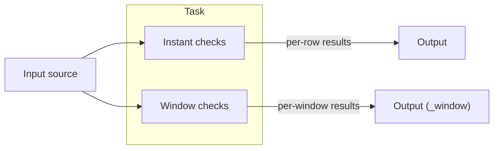

# :compass: User Guide

This guide walks through everything Stream DaQ can do today, from defining a single check to running many monitoring tasks behind a REST API.

!!! tip "How Stream DaQ is organised"
    A **task** reads a stream, applies **checks** to it, and writes the results to an **output**. A **session** runs one or more tasks, each in its own process. You can build tasks in Python, or send them as JSON to the **REST API**.

-   **:gear: Tasks and Sessions**

    ---

    Define what to monitor, and run it.

    [Read more](tasks-and-sessions.md)

-   **:mag: Instant Checks**

    ---

    Check every incoming row: ranges, sets, patterns, comparisons.

    [Read more](instant-checks.md)

-   **:window: Window Checks**

    ---

    Check groups of rows over time: windows, grouping, late data.

    [Read more](window-checks.md)

-   **:straight_ruler: Measures**

    ---

    The full list of built-in measures for window checks.

    [Read more](measures.md)

-   **:white_check_mark: Assessments**

    ---

    How to say what a "good" value is with `must_be`.

    [Read more](assessments.md)

-   **:electric_plug: Inputs and Outputs**

    ---

    Read from Kafka, MQTT, files and more; write results anywhere.

    [Read more](inputs-and-outputs.md)

-   **:satellite: Compact Data**

    ---

    Monitor compact IoT messages in the EVB format.

    [Read more](compact-data.md)

-   **:hammer_and_wrench: Custom Code**

    ---

    Your own measures, assessments, sources and sinks.

    [Read more](custom-code.md)

-   **:globe_with_meridians: REST API and CLI**

    ---

    Run Stream DaQ as a service and manage tasks over HTTP.

    [Read more](rest-api.md)

-   **:arrows_counterclockwise: Hot-swapping and Persistence**

    ---

    Change running tasks and survive restarts.

    [Read more](hot-swapping.md)

-   **:scroll: Logging**

    ---

    Control Stream DaQ's own logs.

    [Read more](logging.md)

-   **:rocket: Advanced Examples**

    ---

    Complete examples combining several features.

    [Read more](advanced-examples.md)

-   **:bulb: Good to Know**

    ---

    Practical notes, such as running tasks in Jupyter.

    [Read more](good-to-know.md)

